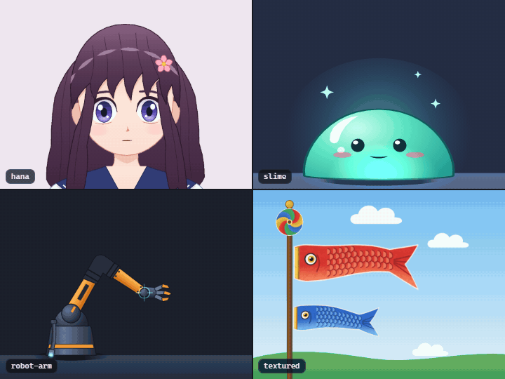
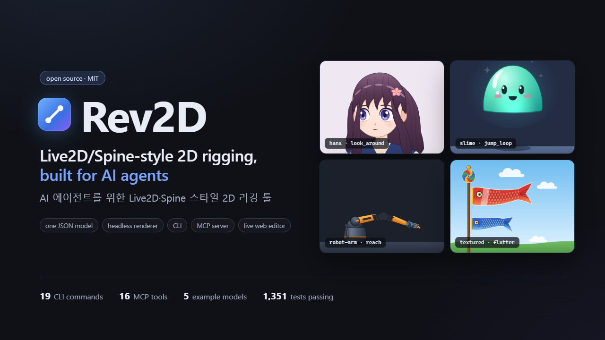
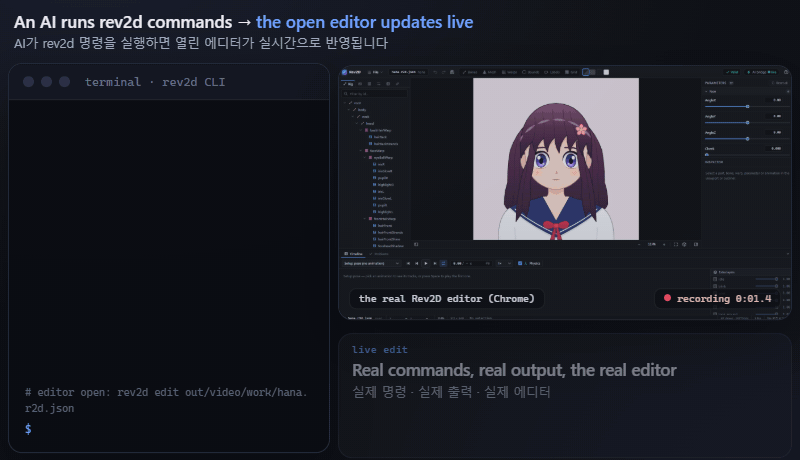
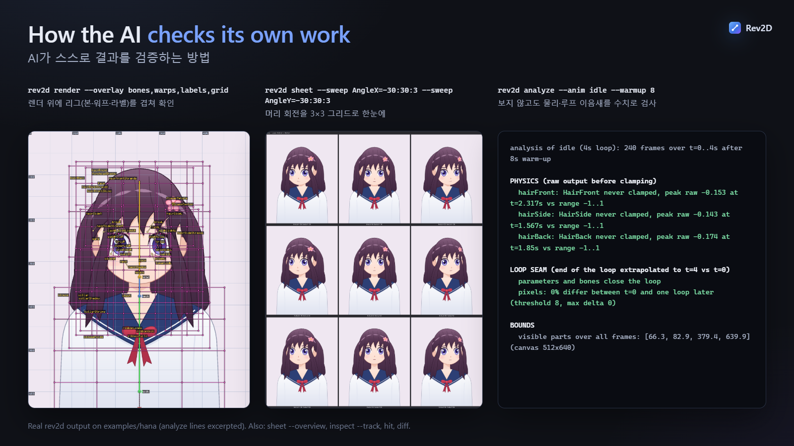
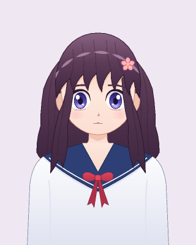
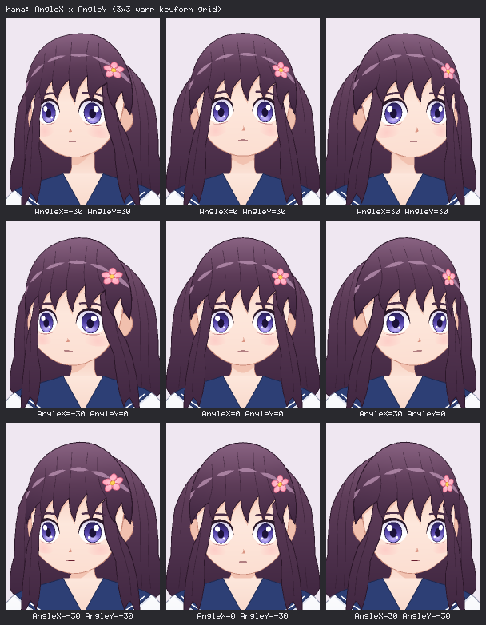
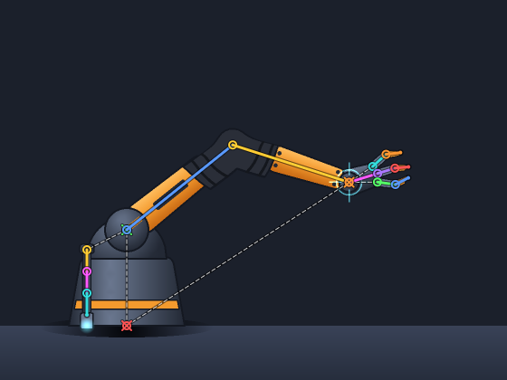
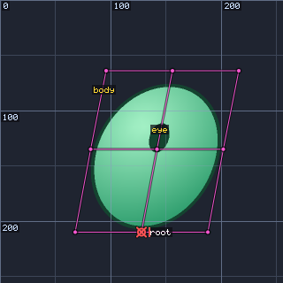
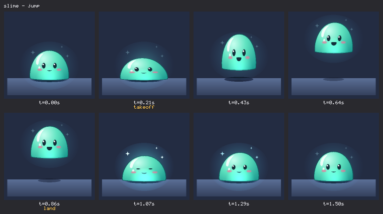

<!--
  게시 전 관리자 확인 사항 (README.md 맨 위 주석과 같은 내용입니다):
  데모 영상: GitHub는 저장소 안의 MP4 링크를 인라인으로 재생하지 않고, 첨부 파일로 올린 영상만
     재생합니다. README.md에 docs/media/rev2d-demo.mp4를 첨부하면서 받은
     https://github.com/user-attachments/assets/<id> URL을 이 파일에도 포스터 링크 바로 아래에
     단독 줄로 넣으면 됩니다(단독 줄에 있는 첨부 URL은 동영상 플레이어로 표시됩니다).
-->

<div align="center">

<h1>Rev2D</h1>

**AI 에이전트를 위해 만든 Live2D·Spine 스타일 2D 리깅·애니메이션 툴킷**

[English](README.md) · **한국어**

[](LICENSE)


[](docs/MCP.md)



<a href="docs/media/rev2d-demo.mp4"></a>

**[▶ 1분 데모 영상 보기](docs/media/rev2d-demo.mp4)** · 영어 헤드라인, 한국어 자막

</div>

## Rev2D란?

- **리그 하나가 JSON 파일 하나입니다.** 파라미터, 본(bone), 워프 디포머, 파츠, 키폼 바인딩, IK,
  물리, 레이어 애니메이션이 모두 `*.r2d.json` 파일 하나에 들어 있습니다. 모든 요소는 id로
  참조하고 좌표는 캔버스 픽셀 단위라서, diff하고 리뷰하고 코드로 생성할 수 있습니다.
- **결정론적 헤드리스 렌더러.** GPU도 브라우저도 쓰지 않는 순수 TypeScript 구현이라, 같은 모델과
  같은 입력이면 언제나 같은 픽셀이 나옵니다. 디버그 오버레이, 컨택트 시트, GIF, PNG 시퀀스를
  렌더합니다.
- **에이전트가 직접 다루는 도구.** `--json` 출력을 지원하는 CLI 명령 21개, 원자적이고 검증되는 편집
  연산(ops), 렌더 결과를 이미지로 돌려주는 MCP 도구 18개를 제공합니다. 자세한 흐름은
  [AI 에이전트 사용법](#ai-에이전트는-rev2d를-이렇게-사용합니다)에 있습니다.
- **Spine·Live2D 파일 가져오기와 내보내기.** Spine 스켈레톤을 모델로 가져오고, 모델을 Spine
  런타임용으로 내보냅니다. Live2D 모션, 표정, 물리는 양방향으로 옮길 수 있습니다.
  [Spine·Live2D 호환](#spinelive2d-호환)을 참고하세요.
- **사람을 위한 라이브 에디터.** React + WebGL2 [에디터](#에디터)가 AI가 쓴 변경을 즉시 다시
  불러오고, AI는 사람이 보고 있는 화면을 똑같이 보고 조작할 수 있습니다.

## AI 에이전트는 Rev2D를 이렇게 사용합니다

기존 리깅 툴은 마우스와 사람의 눈을 전제로 만들어졌습니다. Rev2D는 Live2D와 Spine의 개념은 그대로
두고, 모든 단계를 프로그램이 읽고, 쓰고, 검사할 수 있게 바꿨습니다. 그래서 에이전트는 리그를 만든
뒤 "다 됐습니다"라고 말하기 전에 제대로 동작한다는 것을 스스로 **증명**할 수 있습니다.

한 줄로 요약하면 이렇습니다. **JSON을 쓰고, 렌더와 수치로 확인하고, ops로 고치고, 다시
확인합니다.** 사람이 픽셀을 대신 봐 주지 않아도, 에이전트는 렌더와 시트로 결과를 직접 보고
`inspect`와 `analyze`로 직접 잽니다.

에이전트는 세 가지 경로로 Rev2D에 연결합니다.

| 경로 | 이럴 때 씁니다 | 시작하기 |
| --- | --- | --- |
| **MCP 서버** | Claude Code, Claude Desktop 같은 MCP 클라이언트 | [아래 연결 방법](#claude-code또는-다른-mcp-클라이언트에-연결하기), 도구 18개 |
| **CLI** | 셸을 쓸 수 있는 모든 에이전트 | 모든 명령에 `--json`, 가이드는 [AGENTS.md](AGENTS.md) |
| **에디터 브리지** | 사람이 에디터로 지켜보는 가운데 함께 작업할 때 | `rev2d edit` 후 `rev2d editor ...` 명령 또는 MCP `rev2d_editor_*` 도구 |

### 검증 루프

```text
  ┌─► validate ........... 모든 오류에 JSON 포인터와 수정 힌트
  │     ▼
  │   render ............. 오버레이를 겹친 PNG, 이상한 점이 있으면 경고 메모
  │     ▼
  │   sheet .............. 파라미터 스윕·전체 개요를 이미지 한 장으로
  │     ▼
  │   inspect / analyze .. 정확한 수치: IK, 물리, 루프 이음새
  │     │
  └─────┘ 문제가 있으면 원자적 ops로 고치고 처음부터 다시
```

아래 예시의 `rev2d`는 `node bin/rev2d.js`(체크아웃 안에서는 `npx rev2d`)를 줄여 쓴 것입니다.

| 단계 | CLI | MCP 도구 | 에이전트가 얻는 것 |
| --- | --- | --- | --- |
| 1. 작성 | `rev2d new hero.r2d.json --template hana` 또는 JSON 직접 작성 | `rev2d_create_model` | 유효한 시작 리그(blank, empty 또는 예제 5종 중 하나) |
| 2. 검증 | `rev2d validate hero.r2d.json --json` | `rev2d_validate` | 모든 문제와 각각의 JSON 포인터, 고정 코드, 수정 힌트 |
| 3. 보기 | `rev2d render hero.r2d.json -o out/look.png --overlay bones,warps,labels,grid` | `rev2d_render` | PNG 한 장. 이상한 점이 있으면 메모도 함께(IK 도달 불가, 물리 클램핑, 캔버스 밖 파츠) |
| 4. 스윕 | `rev2d sheet hero.r2d.json -o out/turn.png --sweep AngleX=-30:30:3 --sweep AngleY=30,0,-30` (또는 `--overview`, `--anim idle`) | `rev2d_sheet` | 파라미터 범위, 전체 파라미터, 또는 애니메이션 하나를 캡션이 달린 이미지 한 장으로 |
| 5. 측정 | `rev2d inspect hero.r2d.json --param AngleX=30 --part mouth --json`, `rev2d analyze hero.r2d.json --anim idle --warmup 8` | `rev2d_inspect`, `rev2d_analyze` | 본 변환, 파츠 경계, IK 도달 여부, 물리 클램핑, 루프 이음새를 숫자로 |
| 6. 수정 | `rev2d ops hero.r2d.json edits.json --dry-run`으로 확인한 뒤 `--dry-run` 없이 적용 | `rev2d_apply_ops` | 연산별 리포트. 배치 전체가 적용되고 검증을 통과해야만 파일에 기록됩니다 |

<details>
<summary><b>전체 루프 실제 출력</b>: blank 템플릿에 눈 깜빡임 넣기</summary>

```console
$ node bin/rev2d.js new blob.r2d.json
created blob.r2d.json from template "blank" (512x512; 0 errors, 0 warnings)

$ node bin/rev2d.js ops blob.r2d.json --op '{"op":"add","kind":"parameter","value":{"id":"EyeOpen","min":0,"max":1,"default":1}}' --op '{"op":"bind","target":"part:eye.shape.ry","params":["EyeOpen"],"keys":[{"at":[0],"value":2},{"at":[1],"value":26}]}'
applied 2 ops on blob.r2d.json
  ok  #0  --op #1  add   added parameter "EyeOpen" as /parameters/2 (range 0..1, default 1)
  ok  #1  --op #2  bind  added binding part:eye.shape.ry ← [EyeOpen] as /bindings/3 (2 keyforms)
wrote blob.r2d.json

$ node bin/rev2d.js validate blob.r2d.json
ok    blob.r2d.json  (0 errors, 0 warnings)

$ node bin/rev2d.js sheet blob.r2d.json -o out/blink.png --sweep EyeOpen=0:1:3 --sweep Lean=-1,0,1 --scale 0.5
wrote out/blink.png (800x848, 9 cells, 3 per row, cell viewBox 0,0,512,512, scale 0.5)
cells: EyeOpen=0,0.5,1 x Lean=-1,0,1

$ node bin/rev2d.js inspect blob.r2d.json --param EyeOpen=0 --part eye --json
{
  "time": 0,
  "params": { "Lean": 0, "Squash": 0, "EyeOpen": 0 },
  "drawOrder": ["body", "eye"],
  "properties": { "part:eye.shape.ry": 2 },
  "events": [],
  "ik": [],
  "physics": [],
  "parts": [
    {
      "id": "eye",
      "visible": true,
      "opacity": 1,
      "z": 1,
      "bounds": [241, 235, 30, 4],
      "center": [256, 237]
    }
  ]
}

$ node bin/rev2d.js analyze blob.r2d.json --anim idle
analysis of idle (2s loop): 120 frames over t=0..2s

PARAMETERS (min..max over the frames, [range])
  Lean  -0.5..0.5  [-1..1]
  Squash  0..0.4  [0..1]  reaches min
  constant: EyeOpen=1

LOOP SEAM (end of the loop extrapolated to t=2 vs t=0)
  parameters and bones close the loop
  pixels: 0% differ between t=0 and one loop later (threshold 8, max delta 0)

BOUNDS
  visible parts over all frames: [112.9, 126.5, 286.2, 259] (canvas 512x512)
```

감은 눈의 높이는 4 px이고(`bounds`는 x, y, w, h 순서입니다), 스윕 시트는 `Lean` 값마다 눈이 뜨고
감기는 모습을 보여 주며, idle 루프는 이음새 없이 닫힙니다. `new`가 출력하는 "다음 단계" 안내 줄만
생략했습니다.

</details>

### Claude Code(또는 다른 MCP 클라이언트)에 연결하기

```sh
claude mcp add rev2d -- node /absolute/path/to/Rev2D/bin/rev2d.js mcp
```

`--scope project`를 붙이면 설정이 프로젝트의 `.mcp.json`에 기록되어 팀과 함께 쓸 수 있습니다.

```json
{
  "mcpServers": {
    "rev2d": {
      "command": "node",
      "args": ["/absolute/path/to/Rev2D/bin/rev2d.js", "mcp"]
    }
  }
}
```

stdio 서버를 실행할 수 있는 클라이언트(Claude Desktop, 그 밖의 MCP 클라이언트)는 모두 같은 명령을
씁니다. Windows에서는 경로를 슬래시로 쓰세요(`C:/Users/me/Rev2D/bin/rev2d.js`). 에이전트에게는
먼저 `rev2d_guide`를 호출하라고 알려 주세요. MCP가 없어도 셸을 쓸 수 있는 에이전트라면 CLI를 직접
다룰 수 있습니다. 모든 명령에 `--json`이 있고, 에이전트용 가이드는 [AGENTS.md](AGENTS.md)입니다.

| 그룹 | 도구 | 용도 |
| --- | --- | --- |
| 배우기 | `rev2d_guide` | AI 작성자를 위한 빠른 시작: 규칙, 작업 흐름, 주소 문법, 레시피. **가장 먼저 호출합니다.** |
| | `rev2d_schema` | 모델 전체 또는 일부(`Part`, `Binding`, `Physics`, ...)의 JSON Schema |
| | `rev2d_docs` | 함께 제공되는 문서: spec, ops, cli, mcp, recipes, architecture, examples, agents |
| 확인 | `rev2d_validate` | JSON 포인터, 고정 코드, 수정 힌트가 붙은 진단 |
| | `rev2d_info` | 개요: 파라미터와 각 파라미터가 움직이는 대상, 본 트리, 워프, 파츠, 바인딩, IK, 물리, 애니메이션 |
| 보기 | `rev2d_render` | 포즈 하나를 인라인 PNG로. 오버레이, IK 도달 범위, 경고 메모 포함 |
| | `rev2d_sheet` | 캡션이 달린 격자 한 장: 시간에 따른 애니메이션, 파라미터 스윕 1–2개, 또는 모든 파라미터 개요 |
| | `rev2d_diff_images` | PNG 두 장의 픽셀 diff. 달라진 곳을 빨간색으로 표시 |
| 측정 | `rev2d_inspect` | 한 포즈나 여러 시점의 정확한 수치: 본, 파츠 경계, IK, 물리, 매핑된 점, 트랙 표 |
| | `rev2d_analyze` | 애니메이션 전체를 60 fps로 점검: 값 범위, 물리 클램핑, IK 튐 위험, 이벤트, 루프 이음새 |
| | `rev2d_hit_test` | 캔버스의 한 점을 덮는 파츠를 맨 위부터 나열 |
| 편집 | `rev2d_apply_ops` | id 기반의 원자적이고 검증되는 편집(연산 16종: add, bind, bind_warp, follow, recolor, compose, ...) |
| | `rev2d_create_model` | `blank`, `empty` 또는 예제 템플릿으로 새 모델 만들기 |
| 에디터 브리지 | `rev2d_editor_state` | 사람이 보고 있는 것: 열린 모델, 워크스페이스, 포즈, 시간, 레이어, 선택, 뷰 |
| | `rev2d_editor_command` | 에디터 조작: 파일 열기, 파라미터 설정, 재생, 탐색(seek), 선택, 오버레이, 포커스, 메시지 |
| | `rev2d_editor_screenshot` | 사람이 보는 화면과 똑같은 PNG |

모든 도구의 인자와 결과는 [docs/MCP.md](docs/MCP.md)에 있습니다.

### 라이브 에디터 브리지: 사람이 보고 있는 창에서 AI가 작업합니다



사람은 에디터를 열고, 에이전트는 자기 터미널에서(또는 MCP로) 파일을 수정하고 화면을 조작합니다.
아래는 데모 영상에 나오는 명령 그대로입니다.

```sh
# 사람
rev2d edit hero.r2d.json                       # http://127.0.0.1:4777

# 에이전트
rev2d ops hero.r2d.json --op '{"op":"recolor","parts":["hairBack","hairBackStrands","hairSideR","hairSideStrandR","hairSideL","hairSideStrandL","hairFront","hairFrontStrands","hairFrontShine"],"hsl":{"h":-120,"s":0.25,"l":0.05}}'
rev2d editor command --params AngleX=25,EyeLOpen=0,MouthOpen=0.6
rev2d editor command --play talk
rev2d editor screenshot -o out/seen.png        # 사람이 보는 화면을 그대로 렌더
rev2d editor state                             # 열린 모델, 파라미터, 시간, 레이어, 선택, 뷰
rev2d editor command --message "Hair is teal now, pose set, talk played."
rev2d editor command --open models/cat.r2d.json   # 워크스페이스 안의 다른 모델로 전환
```

- **AI는 사람이 보는 것을 봅니다.** `editor state`는 파라미터(에디터가 계산한 물리 결과와 사람이
  고정한 슬라이더 포함), 시간, 애니메이션 레이어, 선택, 보이는 영역을 알려 주고, `editor screenshot`은
  `rev2d render`와 같은 렌더러로 사람이 보는 화면을 그대로 그려 줍니다.
- **AI가 화면을 조작합니다.** 파라미터, 재생 / 일시 정지 / 탐색, 애니메이션 레이어, 선택, 오버레이,
  포커스, 메시지, 그리고 어떤 파일을 열지까지 바꿀 수 있습니다.
- **편집 내용이 사라지지 않습니다.** 사람이 저장하지 않은 편집이 있는 동안 에이전트가 파일을 쓰면,
  사람의 다음 저장은 거부되고(HTTP 409) 에이전트의 버전을 다시 불러올지 덮어쓸지 직접 고릅니다.

### 이렇게 요청해 보세요

프롬프트는 한국어로 써도 됩니다. 파라미터와 파츠 id(`AngleX`, `EyeOpen` 등)는 파일에 있는 이름
그대로 적으면 됩니다.

> rev2d로 고양이 마스코트를 만들어줘. 고개 돌리기, 눈 깜빡임, 꼬리 물리를 넣고 시트와 `analyze`로
> 검증해줘.

> blank 템플릿으로 `cat.r2d.json`을 만들고 눈 깜빡임을 넣어줘. 눈에 바인딩한 `EyeOpen` 파라미터와
> 0.4초짜리 `blink` 애니메이션이 필요해. 다 됐다고 하기 전에 스윕 시트, 애니메이션 시트, 감은 눈의
> `inspect` 수치를 보여줘.

> 에디터에 `hana.r2d.json`을 열어 뒀어. 머리색을 청록색으로 바꾸고 AngleX 25로 고개를 돌린 다음,
> 내가 볼 수 있게 `talk`를 재생해줘. 그러고 나서 내 화면을 스크린샷으로 찍어서 뭐가 바뀌었는지
> 알려줘.

> hana에게 작은 모자를 씌워줘. 고개를 돌려도 머리 위에 붙어 있어야 해(`follow` op 사용).
> AngleX × AngleY 시트와 모자 기준점의 `inspect --point` 수치로 증명해줘.

> `robot-arm.r2d.json`의 모든 애니메이션에서 IK 도달 범위, 물리 클램핑, 루프 이음새를 분석해줘.
> 찾은 문제는 ops로 고치고 수정 전후 시트를 보여줘.

### AI가 잘 다룰 수 있는 이유

**에이전트가 바로 고칠 수 있는 진단.** 모든 문제에 파일 속 정확한 위치, 고정 코드, 고치는 방법이
붙습니다. 아래는 오타 두 개가 있는 모델에 대한 실제 출력입니다.

```console
$ rev2d validate blob.r2d.json
FAIL  blob.r2d.json
  error   /parts/0/parent     unknown-parent  unknown parent "bodyWarpp" (must be a bone or warp id)  → did you mean "bodyWarp"?
  error   /bindings/1/target  invalid-target  bone has no property "scaleYY"  → did you mean "scaleY"?
  2 errors, 0 warnings
```

**결정론적 렌더.** GPU, 브라우저, 시계, 난수에 의존하지 않으므로 같은 모델과 입력이면 바이트 단위까지
같은 PNG와 GIF가 나옵니다(테스트 스위트가 이를 확인합니다). 그래서 수정 전후의 `rev2d diff`에 의미가
있고, 렌더는 추측이 아니라 증거가 됩니다.

**픽셀만이 아니라 숫자로.** 이미지를 보는 일은 비싸고 모호하지만, 숫자는 싸고 정확합니다.
`AngleX > 0`이면 얼굴이 화면 오른쪽으로 돌아가야 하는데, `inspect`가 이를 확인해 줍니다. hana
예제에 `--param AngleX=30`을 주면 입 중심이 `[256, 321.9]`에서 `[286.9, 322]`로 이동합니다.
`analyze`는 애니메이션을 재생해 보지 않고도 전체를 읽어 냅니다. hana의 idle 루프에서는 머리카락 물리
출력이 한 번도 클램핑되지 않는다는 것, 루프 이음새의 차이가 0%라는 것, 그리고 어떤 파츠가 캔버스
밖으로 나가는지를 알려 줍니다.



## 에디터

`rev2d edit`은 `http://127.0.0.1:4777`에서 웹 에디터(React 19 + WebGL2)를 엽니다. 모델은 CLI와 같은
코어로 계산합니다. 에디터 UI는 영어로 되어 있어서, 아래 표의 메뉴 이름은 화면에 보이는 그대로
적었습니다.

| | |
| --- | --- |
| **라이브 리로드** | AI, CLI, 텍스트 에디터가 디스크에서 바꾼 내용이 바로 나타납니다. 에디터에서 한 편집은 같은 파일에 다시 기록됩니다. |
| **파라미터** | 그룹별 슬라이더(아웃라이너 검색으로도 걸러집니다). 물리 출력을 고정(pin)해 값을 유지할 수 있고, 슬라이더를 더블클릭하면 초기화됩니다. |
| **뷰포트** | 확대와 이동, 클릭으로 파츠와 본 관절 선택, 본·메시·워프·경계·라벨·격자 오버레이(`B` `M` `W` `X` `L` `G`), 미리보기에서 파츠 숨기기(`H`). |
| **타임라인과 레이어** | 재생, 반복, 속도, 물리 켜기/끄기, 트랙별 키, 그리고 가중치·`add`·`start`·`once`를 지정하는 추가 애니메이션 레이어. |
| **아웃라이너와 인스펙터** | 리그 트리, 그리기 순서대로 나열한 파츠, 워프, 파라미터, 애니메이션, 바인딩, IK, 물리. 어떤 객체든 JSON으로 편집하고(`Ctrl+Enter`로 적용), IK와 물리 진단을 실시간으로 봅니다. |
| **문제 패널과 실행 취소** | 편집하는 동안 검증 진단을 보여 주고, 인스펙터 편집은 실행 취소와 다시 실행을 지원합니다. |
| **파일 메뉴** | New…(새 모델, `Alt+N`), Open…(열기, `Ctrl+O`), Open Recent(최근 파일), Save(저장, `Ctrl+S`), Save As…(다른 이름으로 저장, `Ctrl+Shift+S`), Import from computer…(컴퓨터에서 가져오기, 모델 `.json`과 PNG 또는 Spine 내보내기 파일을 끌어다 놓아도 됩니다), Import Live2D motions…(Live2D 모션 가져오기), Download copy(사본 다운로드), Export PNG of the view(현재 뷰를 PNG로 내보내기), Export to ▸ Spine… / Live2D motions…(Spine, Live2D 모션으로 내보내기), Reload from disk(디스크에서 다시 불러오기), Close(닫기). |
| **시작 화면** | 새 모델, 열기, 가져오기, 최근 파일, 그리고 예제 카드(hana, robot arm, slime, textured, minimal). 예제 카드는 예제를 워크스페이스에 복사해서 쓰므로 원본은 그대로 남습니다. |
| **안전 장치** | 편집은 하는 즉시 저장됩니다. 저장에 실패하면(유효하지 않은 모델, 충돌, 삭제된 파일) 에디터가 사람의 버전을 보관하고, New, Open, Import, Close, Reload로 그 내용을 덮어쓰기 전에 Save / Don't save / Cancel(저장 / 저장 안 함 / 취소)을 묻습니다. |
| **워크스페이스** | 에디터는 폴더 하나 안에서만 작업합니다: `rev2d edit [model or dir] --root <dir>`(기본값은 모델이 있는 폴더, 모델이 없으면 현재 폴더). 열기, 만들기, 저장, 가져오기를 모두 이 폴더 안에서만 하며, 심볼릭 링크를 거치는 경우까지 포함해 바깥 경로는 거부합니다. 모델 없이 실행하면 시작 화면이 뜹니다. |

에디터에서 `?`를 누르면 모든 단축키를 볼 수 있습니다.

## Rev2D 속 Live2D·Spine 개념

| 개념 | 출처 | Rev2D에서는 |
| --- | --- | --- |
| 파라미터 | Live2D | 범위, 기본값, 그룹이 있는 이름 붙은 스칼라 값. 바인딩, 애니메이션, 물리가 함께 씁니다. |
| 워프 디포머 | Live2D | `cols × rows` 격자. 중첩할 수 있고 본이나 다른 워프의 자식이 됩니다. `bind_warp`는 yaw/pitch 값으로 의사 3D 고개 돌리기를 생성합니다. |
| 회전 디포머 / 본 | Live2D / Spine | 로컬 x, y, 회전, 스케일, 길이를 가진 본 계층 |
| 키폼 바인딩 | Live2D | 바인딩 하나에 파라미터 1–3개, 빈틈없는 키폼 격자, 다중선형 또는 계단(step) 보간. 한 속성에 걸린 바인딩들은 서로 더해집니다. |
| 셰이프 키 / 디폼 | Live2D / Spine | SVG 패스 모핑, 다각형 점, 메시 정점, 타원·사각형 필드에 대한 키폼 |
| IK 컨스트레인트 | Spine | 원 본 조준(aim)과 투 본 IK. mix, 굽힘 방향, `softness`, `stretch` 지원 |
| 가중치 메시(스키닝) | Spine | 자동 또는 명시적 가중치를 쓰는 선형 블렌드 스키닝 |
| 물리 | Live2D | 고정 60 Hz로 도는 진자 체인. 입력(x, y, 각도)이 출력 파라미터를 움직입니다 |
| 클리핑 마스크, 블렌드 모드 | 둘 다 | `mask` / `maskInvert`(지오메트리와 텍스처 알파), `normal`, `add`, `multiply`, `screen` |
| 그리기 순서 | 둘 다 | `z`, 그다음 배열 순서. `z`도 바인딩하고 애니메이션할 수 있습니다 |
| 애니메이션과 레이어 | 둘 다 | 파라미터나 임의의 속성에 거는 트랙, `smooth`와 cubic-bezier를 포함한 이징, `add`/`override` 레이어, `once` 원샷, 이벤트. `compose`는 레이어 스택을 애니메이션 하나로 굽습니다 |
| 텍스처 | 둘 다 | PNG 텍스처, 이미지 격자로 쓰는 아틀라스 크롭, UV가 있는 텍스처 메시 |

포맷의 세부 사항은 [docs/SPEC.md](docs/SPEC.md), 어떤 예제가 어떤 기법을 쓰는지는
[examples/README.md](examples/README.md)에 있습니다.

## Spine·Live2D 호환

Rev2D는 Spine과 Live2D Cubism이 공개한 JSON 포맷을 읽고 씁니다. 모든 변환은 **보고서**를 함께
돌려줍니다. 근사하거나 버린 기능마다 고정된 코드, 원본 데이터 안의 위치, 해결 방법을 적어 두므로
모르는 사이에 사라지는 데이터가 없습니다.

| | 가져오기 | 내보내기 |
| --- | --- | --- |
| **Spine** (3.8 – 4.2 JSON + 아틀라스 + PNG 페이지) | 새 Rev2D 모델: 본, 텍스처 메시와 가중치 메시, 이미지 시퀀스, 클리핑, IK, 스킨, 모든 애니메이션. 셰어, 상속 모드, 트랜스폼 컨스트레인트는 에뮬레이션하고, 패스·물리 컨스트레인트와 투 컬러 틴트는 보고서에 남깁니다 | Spine 런타임용 스켈레톤 JSON + 아틀라스 + 페이지. 파라미터, 워프, 물리, IK는 애니메이션에 구워 넣습니다 |
| **Live2D** motion3 / exp3 / physics3 / cdi3 / model3 JSON | 모션, 표정, 물리, 이름을 기존 모델에 가져옵니다(검증되는 ops로 적용) | 모션, 물리, 이름, 그리고 파라미터가 같은 Live2D 모델에 합칠 부분 model3.json |

```sh
node bin/rev2d.js import spine spineboy/spineboy-pro.json -o models/spineboy.r2d.json
node bin/rev2d.js export spine hero.r2d.json -o out/hero-spine
node bin/rev2d.js export live2d hero.r2d.json -o out/hero-live2d --anim wave
node bin/rev2d.js import live2d Hiyori/hiyori.model3.json --into hero.r2d.json --dry-run
```

같은 변환을 MCP 도구(`rev2d_import`, `rev2d_export`)와 에디터(File > Import from computer에서
Spine 내보내기 파일 가져오기, File > Import Live2D motions…, File > Export to)에서도 쓸 수 있습니다.

**Live2D `.moc3` 모델 파일은 지원하지 않습니다.** 공개되지 않은 독점 바이너리 포맷이기 때문입니다.
파라미터 ID가 같은 Live2D 모델과 Rev2D 모델 사이에서 모션, 표정, 물리, 표시 이름은 옮길 수 있지만
Live2D 모델의 그림이나 디포머는 옮길 수 없습니다. 실제로는 이렇게 씁니다. AI가 `hana`처럼 Live2D
표준 파라미터를 쓰는 Rev2D 모델에서 모션을 만들고 렌더와 수치로 검증한 뒤 `.motion3.json`으로
내보내면, 여러분은 그 파일을 Live2D 모델에 넣어 Cubism Viewer나 SDK 앱에서 재생합니다. 지원 범위,
좌표 변환, 파라미터 매핑, 단계별 작업 흐름은 [docs/INTEROP.md](docs/INTEROP.md)에 있습니다.

## 빠른 시작

요구 사항: Node 22 이상, git.

```sh
git clone https://github.com/RevStudio/Rev2D.git && cd Rev2D
npm install

node bin/rev2d.js new hero.r2d.json --template hana     # 템플릿: blank(기본), empty, minimal, hana, robot-arm, slime, textured
node bin/rev2d.js validate hero.r2d.json
node bin/rev2d.js render hero.r2d.json -o out/hero.png --overlay bones,warps,labels
node bin/rev2d.js sheet hero.r2d.json -o out/params.png --overview --scale 0.25
node bin/rev2d.js sheet hero.r2d.json -o out/turn.png --sweep AngleX=-30:30:3 --sweep AngleY=30,0,-30 --scale 0.5
node bin/rev2d.js analyze hero.r2d.json --anim idle --warmup 8
node bin/rev2d.js edit hero.r2d.json                    # 라이브 에디터: http://127.0.0.1:4777
```

체크아웃에서는 CLI가 TypeScript 소스를 바로 실행하므로 빌드 단계가 필요 없습니다. 에디터 UI는
`npm run editor:build`를 실행한 뒤에는 `dist/editor`에서 제공되고, 빌드가 없으면 Vite가 즉석에서
컴파일합니다. 4777 포트가 이미 쓰이고 있으면 `--port 0`을 붙여 빈 포트를 고르세요.
`rev2d help <command>`는 모든 플래그를 보여 주고, [docs/CLI.md](docs/CLI.md)에는 모든 명령과 `--json`
출력 형식이 정리되어 있습니다.

**규칙.** 좌표는 원점이 왼쪽 위이고 **+y가 아래쪽**인 캔버스 픽셀입니다. 각도는 도(degree) 단위이며
**시계 방향이 양수**입니다. 표준 파라미터는 Live2D의 이름과 부호를 따릅니다. `AngleX > 0`이면 화면
오른쪽으로 고개를 돌리고, `AngleY > 0`이면 **위**를 보며, id에 붙은 `L`은 캐릭터의 왼쪽, 즉 화면에서는
오른쪽을 뜻합니다.

## 예제

예제 모델 5종이 템플릿으로 들어 있습니다(`rev2d new my.r2d.json --template <name>`). 아래 이미지는
모두 CLI 출력입니다.

<table>
  <tr>
    <td align="center" width="50%"><br><b>hana</b>: 벡터 파츠만으로 만든 Live2D 스타일 흉상. 패스 모핑으로 움직이는 눈과 입, 홍채 마스크, 머리카락 물리</td>
    <td align="center" width="50%"><br><b>hana, 고개 돌리기</b>: AngleX × AngleY 3×3 워프 키폼 격자를 <code>sheet</code> 한 번으로</td>
  </tr>
  <tr>
    <td align="center"><br><b>robot-arm</b>: 투 본 IK(softness), 스키닝된 관절 부트와 케이블, 케이블 물리를 갖춘 Spine 스타일 스켈레톤</td>
    <td align="center"><br><b>minimal</b>: 가장 작은 완전한 리그. 워프, 본, 라벨, 격자 오버레이와 함께</td>
  </tr>
  <tr>
    <td align="center" colspan="2"><br><b>slime</b>: 워프 키폼으로 만든 스쿼시 & 스트레치, 블렌드 모드, 프레임 아래 캡션으로 표시되는 <code>takeoff</code> / <code>land</code> 이벤트</td>
  </tr>
</table>

**textured**(데모 영상 속 잉어 깃발)는 워프로 휘는 PNG 아틀라스 크롭, UV가 있는 텍스처 메시, 텍스처
알파 마스크를 보여 줍니다. 자세한 내용과 기능 매트릭스는 [examples/README.md](examples/README.md)에
있습니다.

## 문서

아래 문서는 모두 영어로 작성되어 있습니다.

| 문서 | 내용 |
| --- | --- |
| [AGENTS.md](AGENTS.md) | AI 에이전트용 가이드: 멘탈 모델, 검증 루프, 진단 읽는 법, 주소 문법, 흔한 실수, MCP 도구, Rev2D 개발 |
| [docs/SPEC.md](docs/SPEC.md) | 모델 포맷과 계산 방식(기준 문서) |
| [docs/CLI.md](docs/CLI.md) | 모든 명령, 플래그, 종료 코드, `--json` 형식 |
| [docs/OPS.md](docs/OPS.md) | 편집 연산 16종, 참조 처리, `bind_warp` 수식 |
| [docs/MCP.md](docs/MCP.md) | MCP 설정, 도구 18개, 에디터 브리지, 문제 해결 |
| [docs/INTEROP.md](docs/INTEROP.md) | Spine·Live2D 가져오기와 내보내기: 지원 범위, 좌표, 파라미터 매핑, 작업 흐름, 제약 |
| [docs/RECIPES.md](docs/RECIPES.md) | 복사해서 쓰는 리깅 레시피 21개와 각각을 검증하는 명령(모두 테스트 스위트가 실행) |
| [docs/ARCHITECTURE.md](docs/ARCHITECTURE.md) | 파이프라인, 모듈, 데이터 계약, 결정론, 에디터 프로토콜 |
| [examples/README.md](examples/README.md) | 예제 모델 5종과 각 모델이 보여 주는 기법 |
| [llms.txt](llms.txt) | LLM 도구를 위한 색인 |

같은 문서를 오프라인으로도 볼 수 있습니다: `rev2d docs <spec|ops|cli|mcp|agents|recipes|interop|architecture|examples>`
또는 MCP `rev2d_docs`.

## 현황과 로드맵

Rev2D는 **v0.1**입니다. 포맷(버전 1), CLI, MCP 도구, 에디터는 동작하며 테스트 1,600개 이상으로 검증되지만,
1.0 전까지는 바뀔 수 있습니다. 아직 npm 배포판은 없으니 체크아웃에서 실행하세요.

Rev2D는 프로덕션 파이프라인에서 Live2D Cubism이나 Spine을 대체하려는 도구가 아닙니다. AI와 함께
만드는 작업과 실험을 위한 텍스트 중심 툴킷입니다. 앞으로 검토해 볼 아이디어는 다음과 같습니다.
아직 약속은 아닙니다.

- 레이어 아트워크(PSD / Photoshop)를 파츠로 가져오기
- 게임 엔진과 웹용 런타임(Unity, Godot, 작은 웹 플레이어)
- 입 파라미터를 움직이는 오디오 기반 립싱크
- 더 많은 컨스트레인트: 더 긴 IK 체인, 트랜스폼·패스 컨스트레인트

아이디어와 사용 사례는 이슈로 남겨 주세요.

## 개발

```sh
npm test                    # 전체 vitest 스위트(테스트 1,600개 이상)
npm run typecheck           # tsc --noEmit -p tsconfig.json
npm run editor:dev          # 핫 리로드되는 에디터 UI. /api는 :4777의 rev2d edit로 프록시
npm run editor:build        # 에디터 UI를 dist/editor로 빌드(rev2d edit가 제공)
npm run build               # src/를 dist/로 컴파일하고 에디터 UI도 빌드(패키지에 들어가는 결과물)
npx tsx scripts/build-examples.ts   # 빌더 스크립트로 examples/ 다시 생성
```

에디터 E2E 테스트는 playwright-core와 설치된 Google Chrome을 사용합니다. UI가 빌드되지 않았거나
Chrome이 없으면 이유를 표시하고 건너뜁니다.

**데모 미디어.** `docs/media`의 모든 파일은 실제 CLI 출력, 실제 렌더, 실제 에디터 화면 녹화로
만들었습니다.

```sh
node scripts/video/capture-all.mjs   # 캡처: CLI 기록, 프레임 시퀀스, 에디터 녹화 -> out/video/assets
node scripts/video/compose.mjs       # 합성: docs/media/*.mp4, hero.gif, ai-live-edit.gif, poster.png, verify.png
```

Google Chrome과 ffmpeg/ffprobe가 `PATH`에 있어야 합니다(Windows에서는 대신 `ffmpeg.exe`가 있는 폴더를
`FFMPEG_DIR`로 지정해도 됩니다). 캡처 단계는 샌드박스 홈 디렉터리를 써서 빈 포트에 에디터를 띄웁니다.

## 기여하기

이슈와 풀 리퀘스트를 환영합니다. PR을 열기 전에 `npm test`와 `npm run typecheck`를 실행하고,
`editor/`를 수정했다면 `npm run editor:build`도 실행해 주세요. 문서도 테스트 대상입니다. 링크, 명령줄,
레시피를 테스트 스위트가 확인합니다. 모듈 경계와 기능을 추가할 위치는
[AGENTS.md 2부](AGENTS.md#part-2-developing-rev2d)에 설명되어 있습니다.

## 라이선스

[MIT](LICENSE) © 2026 RevStudio
