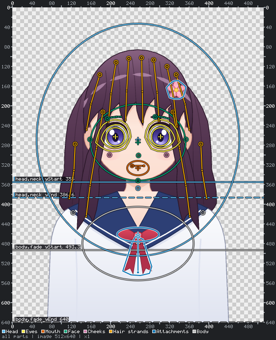
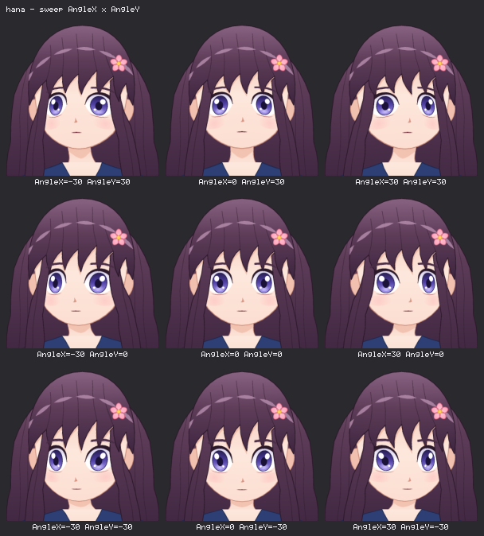
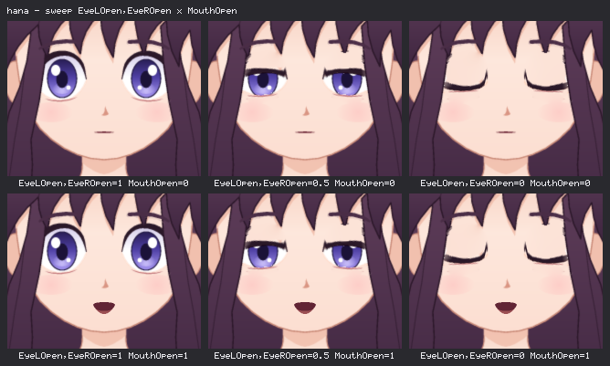

# Avatars from one illustration

Give Rev2D **one picture** (ideally a front-facing bust on a transparent background) and it turns it
into an animated avatar: it blinks, talks, turns and tilts its head, breathes and sways its hair.
You (an AI agent, or a person in the editor) place **landmarks** on the picture: the head, the eyes,
the mouth, the hair strands, the body. Rev2D cuts the picture into layers along them, fills in what
was behind, and generates an ordinary Rev2D model. Everything else in Rev2D then works on it: renders,
sheets, `inspect`, `analyze`, the editor, the Spine and Live2D exporters.

This is the working guide for exactly that job. It is served offline as `rev2d docs avatar` (MCP:
`rev2d_docs {topic: "avatar"}`). Follow the steps in order; every command here is real.

<p align="center"> </p>

<p align="center"><sub>Left: the landmarks of avatar.json on the illustration (<code>rev2d avatar overlay</code>). Right: the built avatar turning its head (<code>rev2d sheet --sweep AngleX --sweep AngleY</code>). The illustration is Rev2D's own <code>hana</code> example rendered to a PNG.</sub></p>

Contents:
[1. What you get, and what it cannot do](#1-what-you-get-and-what-it-cannot-do) ·
[2. The project folder](#2-the-project-folder) ·
[3. The workflow](#3-the-workflow) ·
[4. Placing the landmarks](#4-placing-the-landmarks) ·
[5. Build, review, fix](#5-build-review-fix) ·
[6. The generated model](#6-the-generated-model) ·
[7. Drawn variants](#7-drawn-variants) ·
[8. Lip sync](#8-lip-sync) ·
[9. The editor](#9-the-editor) ·
[10. Importing a Mesh Avatar Studio project](#10-importing-a-mesh-avatar-studio-project) ·
[11. Common problems](#11-common-problems) ·
[12. For programs](#12-for-programs)

Examples write `rev2d` for `node bin/rev2d.js` (or `npx rev2d` inside the checkout). The avatar
commands are CLI commands; the MCP server has no avatar tools yet, so an MCP client runs them from a
shell and reads the PNGs they write.

---

## 1. What you get, and what it cannot do

**You get**

- `<name>.r2d.json`, an ordinary Rev2D model whose coordinates are the pixels of the illustration:
  head turn and tilt (`AngleX`, `AngleY`, `AngleZ`), blinking eyes with gaze, a mouth that opens and
  changes shape, optional brows and blush, body sway and breathing, and one physics-driven parameter
  per hair strand and per swinging or wobbling accessory ([§6](#6-the-generated-model)).
- Six animations: `idle`, `blink`, `talk`, `nod`, `look_around` and `sweep`.
- Review sheets that show every pose worth checking, and numbers for how far each landmark moves.
- Optional **drawn variants**: closed eyes and mouth shapes from an image generator replace the mesh
  deformation where they exist ([§7](#7-drawn-variants)).
- The editor's **Avatar mode**, where a person drags the landmarks with a live preview ([§9](#9-the-editor)).

**It cannot**

- **Invent art.** Every pixel comes from the illustration (or from a drawn variant). A turn of
  ±30 is a pseudo-3D shift of a few percent of the image, not a new view: nothing hidden appears
  (the back of the head, an ear behind hair, teeth that were never drawn).
- **Read every kind of picture equally well.** A front-facing bust with a transparent background
  works best. An opaque background works, but hair and shoulder edges cut less cleanly; a
  three-quarter view turns less convincingly; in a very small picture the eyes are only a few pixels
  wide and are left as they are (`avatar-eye-too-small`). The validator warns below 256 px and above
  4096 px.
- **Use a picture without permission.** Use illustrations you made or have the right to use. A
  picture of someone else's character needs its owner's permission, also for experiments you share.

Everything stays on your machine: the picture, the layers and the model are files in the project
folder, and no command uploads anything. (An in-app agent sends the pictures it works from to the
agent provider the person chose; image generation happens only when the person allowed it.)

## 2. The project folder

An **avatar project** is one folder:

| Path | What it is | Written by | Edit by hand? |
| --- | --- | --- | --- |
| `source.png` | the illustration | `rev2d avatar new` (a byte-for-byte copy) | never: it is never modified |
| `avatar.json` | the avatar spec: the landmarks, build options, `post` ops | you (an agent, or the editor) | **yes: the one file you write** |
| `<name>.r2d.json` | the generated model | `rev2d avatar build` (and the editor when it saves `avatar.json`) | no: every build regenerates it ([§5.4](#54-customise-the-generated-model-post-ops)) |
| `textures/` | the layer images and `layers.json` (layer rects, fingerprints, feature data, sprites) | `rev2d avatar build`, `rev2d avatar variants import` | no |
| `review/` | `poses.png`, `turn.png`, `eyes.png`, `mouth.png`, `summary.json` | `rev2d avatar poses` | no |
| `variant-requests/` | per variant an edit mask and a prompt, plus `README.md` and `preview.png` | `rev2d avatar variants request` | no |
| `variants/` | drawn variants, `<id>.png` at the size of the illustration | an image generator or a person | you add and delete drawings |
| `work/` | scratch: grids, overlays, the vision check | you | yes |
| `avatar.json.bak` | the previous `avatar.json` | the editor, on every save | no |

`<project>` in a command is the folder or its `avatar.json`. Paths inside `avatar.json` are relative
to the folder. If the picture is not yours to publish, keep the project out of version control
(Rev2D's own repository ignores `projects/` and `out/`).

## 3. The workflow

| Step | Command | What you do |
| --- | --- | --- |
| 1. Start | `rev2d avatar new picture.png avatars/hana --name hana` | a project with the picture and a draft `avatar.json` in which every landmark is `null` |
| 2. Check your eyes | `rev2d avatar vision-check make avatars/hana/work/vision`, then `score` | prove that you read pixel coordinates accurately; stop if you cannot |
| 3. Read the picture | `rev2d avatar grid avatars/hana`, then `--region x0,y0,x1,y1` | coordinate grids of the whole picture and of each detail |
| 4. Place | edit `avatar.json`, group by group ([§4](#4-placing-the-landmarks)) | head, face, eyes, mouth, hair, attachments, body |
| 5. Validate | `rev2d avatar validate avatars/hana` after every group | what is missing or wrong, each with a hint |
| 6. Look | `rev2d avatar overlay avatars/hana`, then `--part <id> --zoom` | the landmarks on the picture; correct what is off by more than a few pixels |
| 7. Build | `rev2d avatar build avatars/hana` | layer images and the model; read its warnings |
| 8. Review and fix | `rev2d avatar poses avatars/hana`, look at every sheet, correct landmarks, go back to 5 | until the sheets look right, or another round no longer improves them |

Then, optionally: drawn variants ([§7](#7-drawn-variants)), extra animations through `post` ops
([§5.4](#54-customise-the-generated-model-post-ops)), lip sync ([§8](#8-lip-sync)).

### 3.1 Start a project

```text
$ rev2d avatar new picture.png avatars/hana --name hana
created avatar project avatars/hana: "hana", 512x640
  avatars/hana/source.png   the illustration (a copy; never modified)
  avatars/hana/avatar.json  draft spec: 20 landmarks to place
next steps:
  rev2d avatar grid avatars/hana -o avatars/hana/work/grid.png
  ...
```

Only PNG is accepted (other formats are refused with the way to convert them). An existing project
is not overwritten without `--force`. `--name` is the avatar's id and the name of its model file
(default: the folder name). A project made with Mesh Avatar Studio comes in with
`rev2d avatar import-mas` instead ([§10](#10-importing-a-mesh-avatar-studio-project)).

The draft:

```json
{
  "format": "rev2d-avatar",
  "version": 1,
  "name": "hana",
  "image": { "file": "source.png", "width": 512, "height": 640 },
  "head": { "center": null, "radius": null, "pivot": null, "neck": null },
  "face": {
    "center": null,
    "radius": null,
    "eyes": {
      "imageLeft": { "opening": null, "region": null },
      "imageRight": { "opening": null, "region": null }
    },
    "nose": null,
    "mouth": { "imageLeft": null, "imageRight": null, "bow": 0, "area": { "center": null, "radius": null, "rotation": 0 } },
    "chin": null
  },
  "hair": { "strands": [] },
  "attachments": [],
  "body": { "pivot": null, "fade": null, "sway": 2, "chest": { "center": null, "radius": null } }
}
```

`rev2d avatar schema` prints the JSON Schema of `avatar.json`: every field with its description.
Fields marked "CUTS LAYERS" decide which pixels go into which layer; changing them needs a new
build of the layer images.

### 3.2 Check your eyes first: the vision check

Before placing anything, an agent proves that it reads coordinates off images accurately:

```sh
rev2d avatar vision-check make avatars/hana/work/vision
rev2d avatar grid avatars/hana/work/vision/vision-check.png -o avatars/hana/work/vision/grid.png
rev2d avatar vision-check score avatars/hana/work/vision avatars/hana/work/vision/answer.json
```

`make` writes a busy test picture with 12 numbered crosshair markers and an encoded answer key (do
not decode it). Find the point each crosshair's four arms point at, exactly the way you will read
landmarks (grids, then magnified regions), and write `{"1": [x, y], ..., "12": [x, y]}`. `score`
passes (exit 0) when the mean error is at most 4 px and the largest at most 10 px on the 1024 px
picture, and otherwise names the pattern (a constant shift, a scale factor from measuring a resized
copy, swapped axes). **If you cannot pass it, stop and say so**: landmarks placed blind are worse
than none.

### 3.3 Read coordinates: the grid

```sh
rev2d avatar grid avatars/hana -o avatars/hana/work/grid.png
rev2d avatar grid avatars/hana --region 180,220,260,280 -o avatars/hana/work/eye-left.png
```

The labels on all four sides are **source pixel coordinates** at any magnification, so the numbers
you read are the numbers `avatar.json` wants. Every grid line is a dark and a light pixel side by
side with the coordinate exactly between them. Without `--region` you see the whole picture; with
it the rectangle is magnified by a whole number (an eye-sized region gets a line every 5 px, so you
can read to about 2 px). Make a magnified grid of each eye, the mouth, the hairline, the neck and
every accessory, and **look at every image you make**. With `--json` the answer says where a source
point lands in the image: `origin + (x - x0, y - y0) * scale`.

## 4. Placing the landmarks

Rules for every value:

- **Source pixels**: origin top-left, +x right, **+y down**. A coordinate read off the picture is a
  coordinate in the model.
- **`imageLeft` / `imageRight` are sides of the IMAGE** as you look at it, not the character's. The
  builder maps them to the Live2D ids: the eye on the image left is the character's right eye, so it
  is driven by `EyeROpen`.
- Point lists are flat: `[x0, y0, x1, y1, ...]`. Ellipses are `{center: [x, y], radius: [rx, ry]}`.
  A band is `[yStart, yEnd]` (image rows, yStart < yEnd). Angles are degrees, clockwise-positive.
- Regions such as the head ellipse are **areas of influence** (smooth weights), not cut-outs. Only
  the eye opening and region, the mouth area and the outlines of pendulums and cut-outs cut pixels.

Place one group, run `rev2d avatar validate`, look at it with `rev2d avatar overlay --part <group>`,
then go on. Draw each polygon on a magnified grid.

### Head

| Field | Place it |
| --- | --- |
| `head.center`, `head.radius` | an ellipse around the **whole head with all its hair and head accessories**; horizontally centred on the face, vertically slightly above the eyes. Avoid the shoulders where you can. Hair outside it does not follow the turn. |
| `head.pivot` | the middle of the neck, **below the chin**, above the collarbone: the head tilts around it |
| `head.neck` | `[yStart, yEnd]`: yStart just below the chin (full head motion above it), yEnd near the collarbone (no head motion below it) |
| `head.turn` (optional) | `{x, y}`: pixels the face centre moves at `AngleX` / `AngleY` = ±30. Default 3.5% of the image width / 2.5% of its height |
| `head.tilt` (optional) | head roll in degrees at `AngleZ` = ±30. Default 8.5 |

### Face

| Field | Place it |
| --- | --- |
| `face.center`, `face.radius` | the face oval, **skin only**: from the hairline to the chin, from cheek to cheek. The turn is strongest at its centre and fades toward its edge |
| `face.eyes.imageLeft` / `.imageRight` `.opening` | **cuts layers.** A polygon along the visible eye white and iris **inside the lashes**: 14-20 points, starting at the outer corner and going over the top. No lashes, no skin. This is what closes when the eye blinks |
| `... .region` | **cuts layers.** A polygon 10-20 px **outside** the lashes and the lower lid line: it contains every lash, lid and crease stroke of this eye, and no hair where avoidable |
| `... .iris` (optional) | `{center, radius}` of the iris circle: a better gaze (`EyeBallX` / `EyeBallY`) |
| `face.nose` | the nose tip |
| `face.mouth.imageLeft`, `.imageRight` | the two ends of the **closed** mouth line |
| `face.mouth.bow` | how far the middle of the mouth line lies below the straight line through the corners, px (a smile is positive, default 0) |
| `face.mouth.area` | **cuts layers (for drawn mouths).** `{center, radius, rotation}`: an ellipse a little larger than the lips, room for an open mouth, not reaching the chin or the nose |
| `face.chin` | the tip of the chin |
| `face.brows` (optional) | `{imageLeft, imageRight}`: a polyline of 3-5 points along the middle of each brow. Enables `BrowLY` / `BrowRY`. Leave it out when hair hides the brows |
| `face.cheeks` (optional) | `{imageLeft, imageRight, radius?}`: blush centres. Enables `Cheek` |
| `face.ears` (optional) | `{imageLeft?, imageRight?}`: centres of **visible** ears (they move less than the face when the head turns) |

### Hair strands

`hair.strands` is a list of locks that sway with physics: bangs 3-5 strands, side hair about 2 per
side, back hair where it hangs free.

| Field | Meaning |
| --- | --- |
| `id` | a unique id (it names the parameter `Hair_<id>`) |
| `nodes` | a polyline from the **root** of the lock (on the head) to its **tip**, 2-6 points, **entirely on hair** (never on skin or background) |
| `width` | how wide the sway reaches around the polyline, px: about the visible width of the lock |
| `swing` | largest tip displacement, px (default 10) |
| `stiffness` | > 1 stiffer and faster, < 1 looser and slower (default 1) |
| `group` | `front` (bangs), `side` (beside the face) or `back` (behind the shoulders); default `front` |

The hair layer is grown from the strands through similar colours: the strands decide what counts as
hair. After a build, `textures/hair_mask.png` shows it.

### Attachments

`attachments` is a list of extra pieces, each with a unique `id` and a `kind`:

| Kind | Fields | Use it for |
| --- | --- | --- |
| `pendulum` | `outline` (**cuts layers**: a polygon around the whole hanging object), `pivot` (where it hangs from), `tip` (its free end), `swing` (largest angle, degrees, default 12), `follow` (`head` or `body`, default `head`) | tassels, earrings, ribbon ends: cut into their own layer and swung rigidly from the pivot |
| `jiggle` | `center`, `radius` (an ellipse around the whole mass), `swing` (px, default 4), `follow` | hair buns, pom-poms, a bow: not cut out; a soft area of the picture wobbles |
| `cutout` | `outline` (**cuts layers**: everything that lies in FRONT), `follow` (default `body`), `contact` (optional point where it touches the head) | a hand over the chin, a flower in the hair: cut out, drawn on top, the picture behind it filled in (approximately) |

Rigid things that must not bend with the head (accessories with straight edges) belong in a pendulum
or a cut-out; everything else bends with the lattice.

### Body

| Field | Place it |
| --- | --- |
| `body.pivot` | the middle of the lower torso, near or **below** the bottom of the picture (it may lie outside it): the body sways around it |
| `body.fade` | `[yStart, yEnd]`: full sway above yStart (upper body), none at yEnd (the anchored bottom) |
| `body.sway` | body rotation in degrees at `BodyAngleX` = ±10 (default 2) |
| `body.chest` | an ellipse over the chest: the region that rises when breathing |
| `body.breath` (optional) | pixels the chest rises at `Breath` = 1 (default 0.35% of the image height) |
| `body.shoulders` (optional) | `[[x, y], [x, y]]`: shoulder centres, image left first (they rise a little with each breath) |

### Build options and notes

`build` is optional tuning; leave it out unless the review shows a problem: `cell.body` (the cell
of the whole-image lattice, px; default about 2% of the long side, at most 64 cells per side),
`cell.head` (hair-sized warps; default 0.6 × the body cell), `cell.detail` (eye and mouth warps),
`feather` (soft edge of cut layers, default 1.5 px), `variantTolerance` ([§7](#7-drawn-variants)).
`notes` is a list of free text: write down what you are least sure about.

### Validate after every group

```text
$ rev2d avatar validate avatars/hana
FAIL  avatars/hana/avatar.json
  error   /head/center  avatar-missing-landmark  Head ellipse: centre is not placed yet  → set "center" to [x, y] in source-image pixels: horizontally on the face centre, vertically slightly above the eyes
  ...
  20 errors, 0 warnings
```

A draft validates to one list of what is left (`avatar-missing-landmark`, one per landmark, with
how to place it); everything already placed is checked for geometry (eyes swapped, an opening outside
its region, a landmark outside the head ellipse, bands in the wrong order, ...). Fix every error and
every warning you cannot explain. With `--json` the answer adds `landmarksToPlace` and `layers`:
`"not built"`, `"current"`, or `"stale"` when a landmark that cuts layers changed since the last
build. The full list of codes is in [CLI.md](CLI.md#rev2d-avatar-validate); the frequent ones are
in [§11](#11-common-problems).

### Look at the landmarks on the picture

```sh
rev2d avatar overlay avatars/hana -o avatars/hana/work/overlay.png
rev2d avatar overlay avatars/hana --part eyes.imageLeft --zoom -o avatars/hana/work/eye-left.png
rev2d avatar overlay avatars/hana --part strands --grid -o avatars/hana/work/strands.png
```

Every group has its own colour (legend in the footer). Ellipses get a cross at the centre, polygons
are closed, polylines start with a ring at their root, a band is a solid line at yStart and a dashed
one at yEnd. `--part` takes a group (`head`, `eyes`, `mouth`, `face`, `cheeks`, `strands`,
`attachments`, `body`) or an item id prefix: `head.ellipse`, `head.pivot`, `head.neck`,
`eyes.imageLeft.opening` / `.region` / `.iris`, `mouth.corners`, `mouth.area`, `face.oval`,
`face.nose`, `face.chin`, `face.brows.imageLeft`, `face.ears.imageRight`, `cheeks.imageLeft`,
`strand.<id>`, `attachment.<id>` (`.outline`, `.swing`, `.ellipse`, `.contact`), `body.pivot`,
`body.fade`, `body.chest`, `body.shoulders.imageLeft`. `--zoom` crops to what is drawn and numbers
the vertices of polygons and polylines (their index in the point list), so "point 7 of the opening is
2 px into the lashes" turns into an exact edit.

## 5. Build, review, fix

### 5.1 Build

```text
$ rev2d avatar build avatars/hana
built avatars/hana: "hana", 861 KB model, 22 layer images, 0 warnings
  avatars/hana/hana.r2d.json  27 parameters, 9 warps (7831 lattice points; root 40 x 50 cells), 27 parts, 46 bindings
  avatars/hana/textures       base.png, eyeR_ball.png, ... + layers.json
  time                        1.3 s (layers 604 ms, compile 50 ms, validate 47 ms, fold check 398 ms, write 175 ms)
next steps:
  rev2d avatar poses avatars/hana
```

A build cuts the layer images (`textures/`), compiles the model, applies the `post` ops, validates
the model (0 errors or nothing is written) and **checks it for folds**: every parameter at both ends
of its range, and the corners of `AngleX` × `AngleY` × `AngleZ` × `BodyAngleX`, may not flip or
collapse a lattice cell or a mesh triangle. Problems come back as build issues with a hint (folds name
the parameters and the place). Warnings do not fail the build; read them all. The model is large
(hundreds of KB: the turn keyforms list every lattice point of the head); it is a build artifact.

### 5.2 Review the poses

```sh
rev2d avatar poses avatars/hana
```

Look at every sheet (`--scale 2` for more detail, about four times slower):

| Sheet | What to look for |
| --- | --- |
| `review/poses.png` | **rest** must be the illustration. Eyes half and closed, mouth open, turn left / right, look up / down, tilt both ways, body sway both ways, then every feature pose (eyes 0.25, wink, gaze, visemes a i u e o n, smile, narrow, brows, blush, hair and attachments swung). No tears, no halos, no double contours, no cut chin or ears |
| `review/turn.png` | the 3 × 3 `AngleX` × `AngleY` grid (columns -30, 0, 30; the **top row looks up**). The nose moves farthest, the ears less, the hair silhouette follows; accessories stay rigid |
| `review/eyes.png` | the eye poses magnified. Closed eyes: **one clean lash line, no iris or eye white left**, no pale patch above the lid. Gaze stays inside the opening |
| `review/mouth.png` | the mouth poses magnified. The opening grows downward without stretching the chin; the visemes differ visibly |
| `review/summary.json` | every pose with its parameter values and `moves`: how far each landmark travels, `[dx, dy]` in source pixels (`faceCenter`, `nose`, `chin`, `eyeImageLeft`, `earImageRight`, `neckPivot`, `chest`, ...) |

Cells are small on purpose (a review takes seconds). For subtle questions trust numbers over a
glance: `summary.json` says, for example, that at `AngleX = 30` the nose moves 18 px and the ears 4-5
px. For one pose at full size, or the lattice:

```sh
rev2d render avatars/hana/hana.r2d.json --param AngleX=30 -o avatars/hana/work/turn.png
rev2d render avatars/hana/hana.r2d.json --param AngleZ=30 --overlay warps --only avatarWarp -o avatars/hana/work/tilt-lattice.png
rev2d diff avatars/hana/work/before.png avatars/hana/work/turn.png -o avatars/hana/work/diff.png
```

### 5.3 Fix

Fix what is wrong **by correcting the landmark behind it** in `avatar.json`, then validate, build and
review again. What you see, and what usually causes it:

| You see | Change |
| --- | --- |
| a second outline of hair or head when turning | `head.radius` must cover all hair and head accessories; hair outside it stays behind |
| the chin bends or is cut when tilting (`avatar-chin-weight`) | move `head.pivot` below the chin onto the neck, start `head.neck` just below the chin |
| the neck shears instead of bending (`avatar-pivot-below-neck`) | the pivot belongs between the two rows of `head.neck` |
| iris or eye white left on a closed eye | trace the `opening` inside the lashes, closer to the white |
| lashes or a lid stroke left behind, or a smear above the closed eye | the `region` must contain every lash, lid and crease stroke (10-20 px outside them) |
| skin sways with the hair (`avatar-hair-mask-leak`) | a strand crosses skin or shadow: keep every node on hair; check `textures/hair_mask.png` |
| hair does not sway (`avatar-hair-mask-empty`, `-strand-off`, `-strand-still`) | put strands on the locks, root to tip, with a `width` of at least one lattice cell |
| an accessory bends with the head | make it a `pendulum` or a `cutout` (rigid) |
| a fold warning (`avatar-mesh-fold`) | lower the amount that moves that place (`head.turn`, `head.tilt`, `body.sway`, a strand `swing`) or let it fade over a longer distance (a larger head ellipse or face oval, a longer neck band) |
| the open mouth stretches the chin | shrink `face.mouth.area` so it does not reach the chin |

Stop when the sheets look right, or when another round no longer improves them. Write what you are
least sure about into `notes` and tell the person which landmarks to check first, by their place in
`avatar.json` (for example `face.eyes.imageRight.opening` or the strand `bang3`).

### 5.4 Customise the generated model: post ops

The model is regenerated by every build (and by the editor whenever it saves `avatar.json`): edits
made to the model file, by hand, by `rev2d ops` or in the editor's Rig mode, are lost at the next
build. To customise it, add [edit ops](OPS.md) to the `post` list of `avatar.json`. They are applied
after every build, in order, and must leave a valid model:

```json
"post": [
  { "op": "key", "animation": "wave", "target": "param:AngleZ", "t": 0, "v": 0, "duration": 2.4, "loop": true },
  { "op": "key", "animation": "wave", "target": "param:AngleZ", "t": 1.2, "v": 8, "ease": "inOutSine" },
  { "op": "key", "animation": "wave", "target": "param:AngleZ", "t": 2.4, "v": 0 },
  { "op": "key", "animation": "shy", "target": "param:Cheek", "t": 0, "v": 0, "duration": 2 },
  { "op": "key", "animation": "shy", "target": "param:Cheek", "t": 1, "v": 1, "ease": "inOutSine" },
  { "op": "key", "animation": "shy", "target": "param:Cheek", "t": 2, "v": 0 }
]
```

(`shy` needs the `Cheek` parameter, which exists only with `face.cheeks`.)

The generated ids ([§6](#6-the-generated-model)) are stable as long as the landmarks behind them
exist. A failing post op fails the build and names the op (`the "post" op #0 (set) of avatar.json
failed: unknown part "nope"`).

## 6. The generated model

### Parameters

The ids and ranges are the Live2D standard ones, so Live2D motions drive avatars
([INTEROP.md](INTEROP.md)). A parameter is declared only when something drives it.

| Parameter | Range (default) | Drives | Present |
| --- | --- | --- | --- |
| `AngleX`, `AngleY` | -30..30 (0) | head turn: a 3 × 3 keyform grid on the root lattice; `AngleX > 0` turns toward the screen right, `AngleY > 0` looks **up** | always |
| `AngleZ` | -30..30 (0) | head tilt about `head.pivot`, clockwise for `AngleZ > 0` | always |
| `EyeLOpen`, `EyeROpen` | 0..1 (1) | blink. `L` = the character's left = the eye on the **image right** | with the eyes |
| `EyeBallX`, `EyeBallY` | -1..1 (0) | gaze: the eyeball shifts inside the opening (`EyeBallY > 0` looks up) | with the eyes |
| `EyeLSmile`, `EyeRSmile` | 0..1 (0) | the drawn smiling eyes | with the `eyes_smile` variant |
| `BrowLY`, `BrowRY` | -1..1 (0) | brows up / down | with `face.brows` |
| `MouthOpen` | 0..1 (0) | mouth opening (mesh, or the drawn mouths) | always |
| `MouthForm` | -1..1 (0) | -1 narrow / round ... +1 wide / smile | always |
| `Cheek` | 0..1 (0) | blush opacity | with `face.cheeks` |
| `BodyAngleX` | -10..10 (0) | body sway about `body.pivot` | always |
| `Breath` | 0..1 (0) | the chest rises, the shoulders a little | always |
| `Hair_<strand id>` | -1..1 (0) | the sway of one strand (a physics output) | per strand |
| `Sway_<attachment id>` | -1..1 (0) | a pendulum's swing or a jiggle's wobble (a physics output) | per pendulum / jiggle |

### Structure

| Group | Ids | Notes |
| --- | --- | --- |
| root lattice | warp `avatarWarp` over the whole picture; part `base` (z 0) | one continuous mesh for head, neck and body: turn, tilt, sway and breath are additive offset bindings on it |
| cheeks | parts `cheekR`, `cheekL` (z 10) | blush ellipses, invisible at rest |
| eyes | per eye `eyeR` (image left) / `eyeL` (image right): warps `eyeRUpperWarp`, `eyeRLowerWarp`; parts `eyeR_white` (mask mesh), `eyeR_ball`, `eyeR_upper` (lash band), `eyeR_lower`, rims, crease, hair in front (z 20-25) | the lids meet on an arc; the eyeball mask collapses so nothing of the iris is left |
| mouth | warp `mouthWarp`; parts `mouth`, `mouthInner`, `mouthTongue` (z 30-32) | an opaque patch of the mouth area plus the meshes of the opening |
| hair | warp `hairWarp`; part `hair` (z 50) | one sparse binding per strand |
| brows | parts `browR`, `browL` (z 52) | drawn above the hair |
| attachments | warps `att_<id>Warp`; parts `att_<id>` (pendulums z 60, cut-outs z 70) | rigid follow bindings |
| drawn variants | parts `sprite_<variant>_<imageLeft\|imageRight\|mouth>` (eyes z 27, mouth z 37) | invisible at rest ([§7](#7-drawn-variants)) |

Physics: `hairPhysics_<strand id>` per strand (inputs `AngleX`, `AngleZ`, `BodyAngleX`) and
`att_<id>` per pendulum or jiggle; outputs are the `Hair_*` / `Sway_*` parameters. The exact part list
depends on the picture (a part whose layer would be empty is left out): `rev2d info` lists them.

### Animations

| Animation | Length | What it does |
| --- | --- | --- |
| `idle` | 8 s loop | two breaths, slow body sway, gentle head motion, blinks at uneven times, one glance |
| `blink` | 0.3 s | one blink: play it `once` over another animation |
| `talk` | 2.4 s loop | mouth open / half / closed with some mouth form |
| `nod` | 1.2 s | a nod |
| `look_around` | 7 s loop | head and eyes look around |
| `sweep` | 18 s loop | `AngleX`, `AngleY`, `AngleZ` through their ranges, for reviews |

Animations only key parameters that exist, never physics outputs; every looping track ends on its
first value.

### Verify it like any model

The normal Rev2D loop ([AGENTS.md §1.3](../AGENTS.md#13-the-verify-loop)) works on the generated model:

```sh
rev2d info avatars/hana/hana.r2d.json
rev2d sheet avatars/hana/hana.r2d.json -o avatars/hana/work/turn-grid.png --sweep AngleX=-30,0,30 --sweep AngleY=30,0,-30
rev2d sheet avatars/hana/hana.r2d.json -o avatars/hana/work/blink.png --sweep EyeLOpen,EyeROpen=1,0.5,0 --sweep MouthOpen=0,1 --viewbox 150,200,212,170
rev2d sheet avatars/hana/hana.r2d.json -o avatars/hana/work/hair.png --sweep Hair_bang3=-1,0,1
rev2d analyze avatars/hana/hana.r2d.json --anim idle --warmup 10
rev2d inspect avatars/hana/hana.r2d.json --param AngleX=30 --point 257,301@avatarWarp
```

<p align="center"></p>

`analyze --warmup 10` reports whether the hair physics clamps (on the test illustration the strands
stay within about a third of their range in `idle`). Its note "parts leave the canvas: base" is
expected on an avatar: the picture fills the whole canvas, so any tilt or sway moves an edge of it
outside. `inspect --point` maps a setup point through the lattice (on the test illustration the
nose tip at `(257, 301)` moves about 18 px to the right at `AngleX = 30`).

## 7. Drawn variants

A mesh can only move pixels that exist. A closed eye made by pulling the lid down, or an open mouth
made by stretching the lips, is always a compromise; the same picture **drawn** with the eyes closed
or the mouth open looks right. A drawn variant is a full-size copy of the illustration in which one
thing is redrawn by an image generator (or a person); Rev2D cuts the redrawn area out as a
**sprite** that replaces the mesh deformation. The mesh stays the fallback for every variant
without a drawing.

| Variant | Shown |
| --- | --- |
| `eyes_closed` (recommended) | per eye, fully up to `EyeOpen` 0.12, gone at 0.2 |
| `eyes_half` | per eye, fully from `EyeOpen` 0.3 to 0.6, gone at 0.2 and 0.7 (under a closed sprite down to 0) |
| `eyes_smile` | per eye by `EyeLSmile` / `EyeRSmile` (declared only with this variant), on top |
| `mouth_a` (recommended), `mouth_a_half`, `mouth_i`, `mouth_u`, `mouth_e`, `mouth_o` | at their point of the `MouthOpen` × `MouthForm` viseme table: a (1, 0), a_half (0.5, 0), i (0.35, 1), u (0.35, -1), e (0.6, 0.5), o (0.75, -1). Above `MouthOpen` 0.15 the nearest drawn shape shows (it stands in for a missing one), at 0.15 and below the closed mouth of the illustration. With drawn mouths the mesh mouth keeps `MouthForm` only |

While a sprite covers an eye completely, the eye's mesh layers are hidden; every change between a
sprite and the mesh eye, or between two sprites, is one fully drawn picture fading over another.
With only `mouth_a` drawn, every opening above about 0.175 shows the full "a": draw `mouth_a_half`,
`mouth_i` and `mouth_u` for variety.

### The flow

```sh
rev2d avatar variants request avatars/hana
rev2d avatar variants import avatars/hana
rev2d avatar variants status avatars/hana
rev2d avatar poses avatars/hana
```

1. **Request** (the avatar must be built). Without ids it requests `eyes_closed` and `mouth_a`;
   name ids (`rev2d avatar variants request avatars/hana eyes_closed eyes_half mouth_a`) or `--all`.
   Per variant `variant-requests/` gets `<id>.mask.png` (the edit mask), `<id>.prompt.txt` (what to
   draw, where, and the hard constraints), plus `README.md` and `preview.png` (the editable areas
   tinted on the picture).
2. **Draw** each variant: give the image generator `source.png`, the mask and the prompt; save the
   result as `variants/<id>.png` at exactly the size of `source.png`. Look at it next to the source.
3. **Import** checks every drawing and cuts the accepted ones into sprites
   (`textures/sprite_<id>_<area>.png`), then rebuilds the model from the existing layers.
4. **Review** `review/eyes.png`, `review/mouth.png` and `review/poses.png`: the sprite must sit
   exactly on the eyes or the mouth, without a seam, halo or colour step, and the face must not jump
   between a sprite and the poses next to it. A variant that looks worse than the mesh is drawn again
   or removed: delete `variants/<id>.png` and import again.

In the editor the **Drawn Variants** section of Avatar mode does the same steps with buttons:
**Draw with AI…** (request, draw and import in one agent job), **Import Drawings** (for files you put
into `variants/` yourself), and in its menu **Write Masks and Prompts** and **Open the Instructions**
([§9](#9-the-editor)).

### The mask

At the size of the illustration: **opaque black = must stay identical, transparent (white) = may
change**, soft in between. Eye variants share both eye regions, slightly grown (by 8% of the
region's size); mouth variants the mouth area ellipse (grown by 5% of its smaller radius). Moving an
eye region or the mouth area therefore changes the masks.

### The check

A drawing is accepted when:

- its size is exactly the size of the source;
- **outside the mask** nothing changed: a mean difference of at most `build.variantTolerance` (default
  2 of 255, recompression noise passes), at most 0.5% of the pixels changed by more than 40 levels,
  and in the ring just around the edit area (where the sprite blends in) at most 2.5 × the tolerance.
  Pixels of the source's transparent background do not count;
- the picture is **not shifted or zoomed**: when the outside does not match, the check looks for a
  global shift (up to 8 px) or zoom (up to 8%) that explains it and names it ("shifted by 3 px to the
  right"); a shift of 2 px or more is rejected;
- **inside the mask** something changed: at least 2% of the editable area, for each eye of an eye
  variant.

A rejected drawing is reported with the reason and a hint that says what to ask the image generator
next (for example to keep exactly the same framing), and `import` exits 1; the accepted drawings of the
same run are imported all the same, and an earlier accepted sprite of a rejected variant stays. Every
rejection also has a stable code (`--json`: `checks[].code`): `size`, `zoom`, `shift`, `outside`,
`bad` (something added or repainted outside the editable area), `seam`, `unchanged`, `one-eye` (only
one eye redrawn) or `unreadable` (not a readable PNG).

```text
$ rev2d avatar variants import avatars/hana
imported 1 drawing of avatars/hana: 0 accepted, 1 rejected
  eyes_closed  REJECTED  nothing changed inside the editable area: 0% of it differs from source.png (at least 2% must)
                         hint: The generator returned the picture (nearly) unchanged. Ask the image generator again with source.png and the mask variant-requests/eyes_closed.mask.png (...)
```

`status` lists every variant with one state: `missing`, `requested`, `drawn` (not imported yet),
`accepted`, `rejected` (with the reason) or `stale`.

### Stale variants

A sprite is cut for the eye regions, the mouth area and the layers of one build. After you move an
eye region or the mouth area, or rebuild the layers, `rev2d avatar build` reports
`avatar-variant-stale` and `status` shows `stale`: request again (the masks changed), check that the
drawing still fits the new mask, and import again. A sprite image deleted by hand is reported as
`avatar-variant-sprite-missing`; import again to cut it.

### Image generation needs consent

Draw variants with an image generator **only when the person allowed it**. The picture goes to the
generator, so it must be one the person may use that way. An agent uses only its own built-in
generator and never sends the illustration to another service or website. In the editor, **Draw
with AI…** says before it starts that the illustration and the edit masks go to the provider's image
generator; the `avatar-variants` job it starts ([§9](#9-the-editor)) runs only with image generation
allowed, with a provider that has an image generator (Codex), and on a built avatar.

## 8. Lip sync

`src/lipsync` turns text or audio into mouth motion on `MouthOpen` / `MouthForm`, using the same
viseme table as the drawn mouths:

| Viseme | a | i | u | e | o | n / rest |
| --- | --- | --- | --- | --- | --- | --- |
| `MouthOpen` | 1 | 0.35 | 0.35 | 0.6 | 0.75 | 0 |
| `MouthForm` | 0 | 1 | -1 | 0.5 | -1 | 0 |

- **Text**: kana (hiragana and katakana), Hangul and romaji, with an English-like fallback for other
  Latin text. Each mora or syllable is a beat with a viseme; long vowels, small kana, final consonants
  and punctuation change the beat lengths. Kanji and digits become short rests and are reported as
  `unknown`. `rate` is beats per second (default 7; natural speech is about 4-12).
- **Audio**: `decodeWav` reads a PCM WAV file; `lipSyncFromAudio` keys `MouthOpen` from its loudness
  (30 fps by default, smoothed).

In the editor, Avatar mode's **Lip Sync** page plays text on the live preview (vowel buttons hold a
shape while pressed; speed and loop are adjustable). It plays no sound and writes nothing.

To put speech into the model, make an animation and add it with an op. There is no CLI command for
this yet: in a checkout, a short script calls the library (it is not exported from the package entry
point). Save this as `out/lipsync.ts`:

```ts
// out/lipsync.ts: text -> a lip-sync animation as an "add" op (run from the checkout root)
import { lipSyncFromText } from '../src/lipsync/index.js';

const [text = 'こんにちは', id = 'hello'] = process.argv.slice(2);
const { animation, duration, unknown } = lipSyncFromText(text, { id, rate: 7 });
if (unknown.length) console.error(`read as pauses: ${unknown.join(' ')}`);
console.error(`${id}: ${duration.toFixed(2)} s`);
console.log(JSON.stringify([{ op: 'add', kind: 'animation', value: animation }], null, 2));
```

```sh
npx tsx out/lipsync.ts "こんにちは、ハナです" hello > out/hello-ops.json
rev2d ops avatars/hana/hana.r2d.json out/hello-ops.json --dry-run
rev2d sheet avatars/hana/hana.r2d.json -o avatars/hana/work/hello.png --anim hello --frames 8 --viewbox 216,296,80,48 --scale 3
```

To keep the animation across builds, put the op from `hello-ops.json` into the `post` list of
`avatar.json` ([§5.4](#54-customise-the-generated-model-post-ops)); `rev2d ops` on the model file is
fine for a quick look, but the next build overwrites it. Play speech over the idle as a layer
(`--anim idle --anim hello,add,once`), and check it with `rev2d analyze --anim hello`. For audio, the
script reads the file with `decodeWav(new Uint8Array(readFileSync('line.wav')))` and calls
`lipSyncFromAudio(audio, { id: 'line' })` instead. Pass `formParam: ''` to leave the `MouthForm`
track out.

## 9. The editor

```sh
rev2d edit avatars/hana
rev2d edit avatars/hana/avatar.json
```

An avatar project (its folder or its `avatar.json`) opens in **Avatar mode**; the workspace root is
the folder that holds the project (`avatars/`), so new avatars can be created next to it.

### New avatar from an illustration

The start screen's **Avatar from an Illustration** card, or **File > New Avatar from
Illustration…**: drop a PNG (a front-facing bust on a transparent background works best; an opaque
picture is accepted with a note), name the project, and choose who places the landmarks:

- **Let AI Place Them**: the editor creates the project and starts the AI panel's
  `avatar-create` task. The agent runs the vision check, places the landmarks, validates, builds,
  reviews the poses and fixes what is off, while you watch every change. It ends with a note naming
  the parts it is least sure about. Needs the AI panel ([below](#the-ai-panel)); "Copy the Request"
  gives the same request for an agent in your own terminal.
- **Place Them Myself**: a checklist shows the landmarks still to place; click one, then click
  where it belongs on the picture, and drag it into place afterwards. **Build Avatar** appears once
  everything is placed and valid.

### Avatar mode

- **Parts** (leading sidebar): the landmarks by category (Face, Hair & Accessories, Body) and
  group, each with its colour, a description and a toggle for its handles; missing and optional
  parts are marked, absent optional groups offer to add one (a hair strand, a pendulum, a jiggle, a
  cut-out). The problems of the spec are listed at the bottom; a click selects the part. A part's
  context menu has Fit, Place on the Picture, Show / Hide handles, **Ask AI to Fix This Part** and
  Remove.
- **Canvas**: the illustration with a handle on every landmark. Drag a handle to move it (points,
  centres, radii, rotation, band rows, polygon vertices); click a part to select it.
- **Preview** (trailing sidebar): the avatar compiled live in the browser from `avatar.json` and the
  current layers, updated while you drag. Under it three pages and a section:
  - **Pose**: sliders for turn, look, tilt, eyes, gaze, brows, mouth, blush, body and breath (and
    every other parameter under More Parameters), Reset Pose, and the **Idle** switch (the idle
    animation with physics).
  - **Lip Sync**: hold a vowel button, or type kana, Hangul or romaji and play it ([§8](#8-lip-sync)).
  - **Selected**: the numbers of the selected part for exact edits, its placement tip, its problems.
  - **Drawn Variants** ([§7](#7-drawn-variants)): every variant with a thumbnail and its state:
    **In Use**, **Out of Date** (import again), **Rejected** (the reason in your language, the
    English detail in the tooltip), **Not Imported**, **Requested** or **Not Drawn**. A row's menu
    has Show in Preview and Remove Drawing (the mesh takes over again). **Draw with AI…** opens a
    sheet: choose the variants, read that the illustration and the edit masks go to the provider's
    image generator, and start an `avatar-variants` job with image generation allowed (Codex only;
    with another agent the sheet says why and offers Copy the Request for an agent in a terminal).
    **Import Drawings** checks the files you put into `variants/` yourself, as a job like a build.
    The section's menu writes the masks and prompts or opens the instructions
    (`variant-requests/README.md`).
- **Saving**: in Avatar mode the toolbar's Save, Undo and Redo (Ctrl+S, Ctrl+Z, Ctrl+Shift+Z /
  Ctrl+Y) work on `avatar.json`. Saving recompiles the model from the existing layer images. When a
  landmark that cuts layers moved, the preview still uses the old cut-outs and a banner says
  **"Outlines changed. Rebuild the layers to update the preview."** with **Save and Rebuild Layers**.
  If an agent or another program writes `avatar.json` while you have unsaved edits, a banner offers
  Keep Mine or Reload; nothing is overwritten silently.
- After the first build the mode switcher also offers the **Rig** mode for the generated model (a
  newly opened avatar project starts in Avatar mode). Changes made there are lost at the next build;
  put lasting changes into `post` ([§5.4](#54-customise-the-generated-model-post-ops)).

### Working with the person

An agent in its own terminal sees and drives the person's editor as usual
([AGENTS.md §1.10](../AGENTS.md#110-working-with-a-human-the-live-editor)):

```sh
rev2d editor state
rev2d editor command --open avatars/hana/avatar.json
rev2d avatar overlay avatars/hana --part eyes.imageLeft.opening --zoom
```

`editor state` names the project (`avatar project <dir> (no built model yet)` before the first
build) and the part the person selected (`avatar part: eyes.imageLeft.opening`), an id that
`rev2d avatar overlay --part` takes. Every write to `avatar.json`, the layers or the model shows in
their editor at once. Read `avatar.json` again before you write it: they may have moved a handle.

### The AI panel

The sparkles button of the toolbar opens the AI panel: a conversation with the **Codex CLI** or
**Claude Code**, started by the editor in the workspace with the person's own login of that CLI. It
needs one of them installed and signed in, and the editor on a loopback address (the default; see
[AGENT-BRIDGE.md](AGENT-BRIDGE.md) for `--allow-agent`, the token and the Windows Codex sandbox
setting). Its Tasks include the two avatar templates:

| Task | Context | What the agent does |
| --- | --- | --- |
| Create an avatar from this illustration (`avatar-create`) | the project, the illustration attached | the workflow of [§3](#3-the-workflow), then a hand-over note naming the parts it is least sure about; it writes only `avatar.json` and `work/`, and never generates pictures |
| Draw eye and mouth variants (`avatar-variants`) | the project, optionally the variant ids | request, draw with its **built-in** image generator, import, rebuild and review ([§7](#7-drawn-variants)). Needs image generation allowed, a provider with an image generator, write access and a built avatar. Avatar mode's **Draw with AI…** starts it with the chosen variants |

"Ask AI to Fix This Part" in a part's menu starts a request about that one landmark, with its
placement tip and its problems. If you are the agent in that panel: you work inside the project
folder, this guide is your task description, and the person sees your edits live.

## 10. Importing a Mesh Avatar Studio project

Rev2D's avatar workflow was inspired by **Mesh Avatar Studio**, an open-source (MIT) tool that
rigs one illustration from expert-placed landmarks. Rev2D's builder is an independent
implementation; none of its code is used. Its projects import:

```sh
rev2d avatar import-mas mas-project avatars/aki
rev2d avatar validate avatars/aki
rev2d avatar overlay avatars/aki -o avatars/aki/work/overlay.png
```

The Mesh Avatar Studio folder holds `rig.json` (version 1) and `source.png` (or name the `rig.json`
itself and pass the picture with `--image`). Radians become degrees, `eyes[0]` / `eyes[1]` become `imageLeft` / `imageRight`, the
mouth line becomes two corners, strands, buns (jiggles), accessories (pendulums) and the hand (a
cut-out with its contact point) carry over, and drawn variants with names Rev2D knows are copied to
`variants/` (import them with `rev2d avatar variants import`). Mesh Avatar Studio has no face oval
and no chin point: both are estimated. Everything estimated, approximated or not imported is printed
as a `note:`; read them, then check the overlay: pendulum outlines arrive as bounding boxes (trace
them around the object), and ears are imported even where hair hides them.

## 11. Common problems

**Spec diagnostics** (`rev2d avatar validate`; [full table](CLI.md#rev2d-avatar-validate)):

| Code | Meaning | Fix |
| --- | --- | --- |
| `avatar-missing-landmark` | a landmark is still `null` | place it as the hint says |
| `avatar-image-size-mismatch` | `image.width` / `height` differ from the picture | copy the real size (`avatar new` fills it in) |
| `avatar-eyes-swapped` | `imageLeft` is not left of `imageRight` | they are sides of the IMAGE: swap the two eyes |
| `avatar-eye-opening-outside-region` | the opening is not inside its region (or the two are swapped) | the opening is the inner polygon, the region the outer one |
| `avatar-eye-opening-exceeds-region` | a few opening points stick out of the region | move those points in, or grow the region |
| `avatar-outside-head` | an eye, the nose, a mouth corner or the chin lies outside the head ellipse | enlarge `head.radius` (it covers the whole head with its hair) |
| `avatar-neck-above-chin` | the neck band starts so far up that the chin keeps < 90% of the head motion | start `head.neck` just below the chin |
| `avatar-band-order` | a band with yStart >= yEnd | `[top row, bottom row]` |
| `avatar-mouth-corners-swapped`, `avatar-mouth-area` | corners swapped; the area holds no corner | image-left corner first; the area surrounds the lips |
| `avatar-polygon-self-intersects` | polygon edges cross | order the points around the outline (the message names the edges) |
| `avatar-reserved-id`, `avatar-duplicate-id` | an attachment id names a generated layer (`hair`, `mouth`, ...), or ids repeat | choose another id |
| `avatar-implausible-value` | turn / tilt / sway / swing far from usable values | degrees, not radians; pixels where pixels are asked |

**Build issues** (`rev2d avatar build`):

| Code | Meaning | Fix |
| --- | --- | --- |
| `avatar-mesh-fold` | a lattice cell or mesh triangle flips or collapses in a pose (named with the place) | lower `head.turn` / `head.tilt` / `body.sway` / a strand `swing`, or let the motion fade over a longer distance |
| `avatar-chin-weight` | the chin gets < 90% of the tilt: the jaw bends | `head.pivot` on the neck below the chin, `head.neck` starting just below the chin |
| `avatar-pivot-below-neck` | the pivot lies below the neck band: the tilt shears | move the pivot up into the band |
| `avatar-eye-too-small`, `avatar-eye-hidden` | an eye is too small to cut, or hidden: it is left as it is | trace the opening on the visible white; use a larger picture |
| `avatar-eye-covered` | more than half of the eye region is covered by hair | draw the region on skin; hair over the eye stays in front by itself |
| `avatar-brow-not-found` (info) | no brow ink along the brow line | trace the middle of the visible brow, or leave `face.brows` out |
| `avatar-mouth-line` | no mouth line between the corners | put the corners on the ends of the closed mouth |
| `avatar-hair-mask-empty`, `avatar-hair-strand-off` | the strands do not lie on hair | keep every node on the lock; look at `textures/hair_mask.png` |
| `avatar-hair-mask-sparse` | the hair mask covers little of the head | add strands on the missed locks, or enlarge `head.radius` |
| `avatar-hair-mask-leak` | the hair mask takes in the lower face | a strand crosses skin or shadow, or the face oval / nose are misplaced |
| `avatar-hair-strand-still` | a strand moves no lattice point | a `width` of at least one lattice cell, on hair |
| `avatar-attachment-empty`, `avatar-attachment-still` | nothing to cut inside an outline; a jiggle ellipse smaller than a cell | draw the outline around the object; make the ellipse cover the whole mass |
| `avatar-variant-stale`, `avatar-variant-sprite-missing` | sprites cut for other regions or layers, or deleted | `rev2d avatar variants import <project>` ([§7](#7-drawn-variants)) |
| `avatar-cell-clamped` (info) | `build.cell.body` needs more than 64 cells per side and was raised | nothing, or a larger cell |

Model validation warnings of the built model use the codes of `rev2d validate`
([AGENTS.md §1.4](../AGENTS.md#14-reading-diagnostics)).

## 12. For programs

The builder is pure TypeScript and browser-safe (the editor compiles avatars in the browser); file
IO is separate. Inside the checkout:

| Module | Entry points |
| --- | --- |
| `src/avatar/index.ts` | `parseAvatarSpec(input, {imageSize?})`, `draftAvatarSpec(name, w, h)`, `buildAvatarLayers(spec, source, previous?)` (stage 1: image processing), `compileAvatar(spec, meta)` (stage 2: the model document; fast), `avatarReviewPoses`, `findFolds`, `describeAvatarParts(doc)`, `avatarGrid` / `avatarOverlay` / `makeVisionCheck`, `importMasRig`, `avatarVariantRequests`, `checkAvatarVariant`, `buildAvatarSprites`, `avatarJsonSchema()` |
| `src/node/avatar.ts` | `createAvatarProject(image, dir)`, `loadAvatarProject(dir)`, `buildAvatarProject(dir)`, `reviewAvatarProject(dir)`, `importMasProject` |
| `src/node/avatar-variants.ts` | `writeAvatarVariantRequests`, `importAvatarVariants`, `avatarVariantStatus` |
| `src/lipsync/index.ts` | `textToMorae`, `lipSyncFromText`, `lipSyncFromMorae`, `mouthShapeAt`, `decodeWav`, `lipSyncFromAudio`, `VISEME_SHAPES` |

How the builder works inside (the pipeline, the deformation fields, the quality bar):
[src/avatar/DESIGN.md](../src/avatar/DESIGN.md). Where the modules sit:
[ARCHITECTURE.md](ARCHITECTURE.md#6-avatar-builder-and-lip-sync).

## Asset libraries and MCP

Avatar projects can be registered as reusable character poses in a [library](LIBRARY.md). Use `library rig` to build/fingerprint them and `library validate` to check a consistent parameter interface. MCP now exposes `rev2d_avatar_new`, `rev2d_avatar_validate`, `rev2d_avatar_grid`, `rev2d_avatar_overlay`, `rev2d_avatar_build` and `rev2d_avatar_poses`; image tools return inline PNGs. Imported poses require measured landmarks. Whole-body articulated acting remains a later Studio phase.
